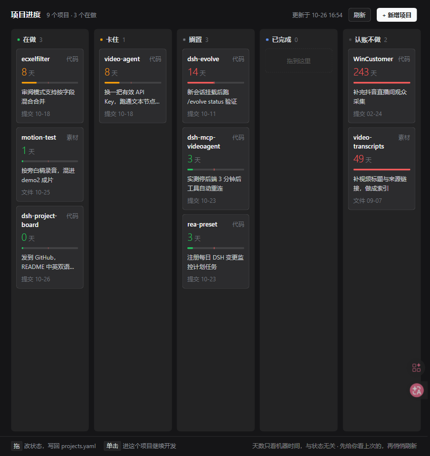
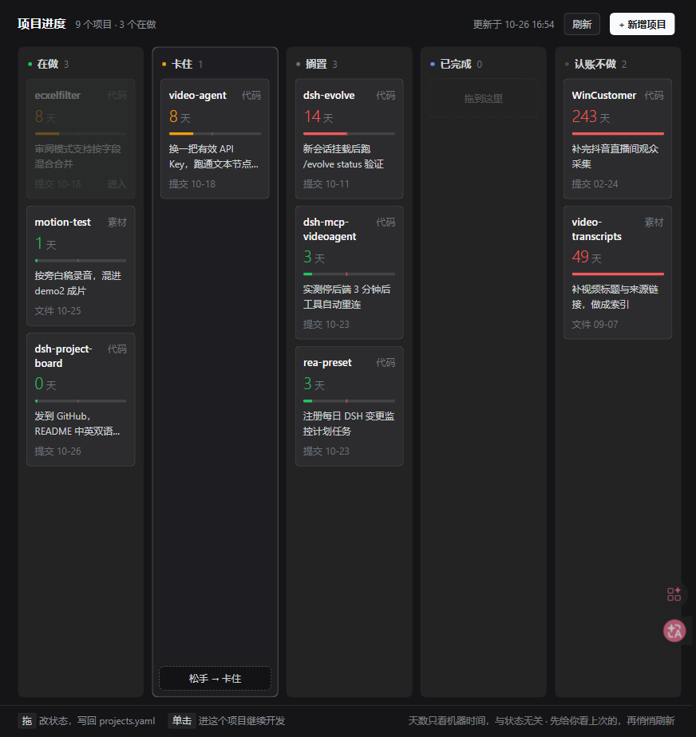
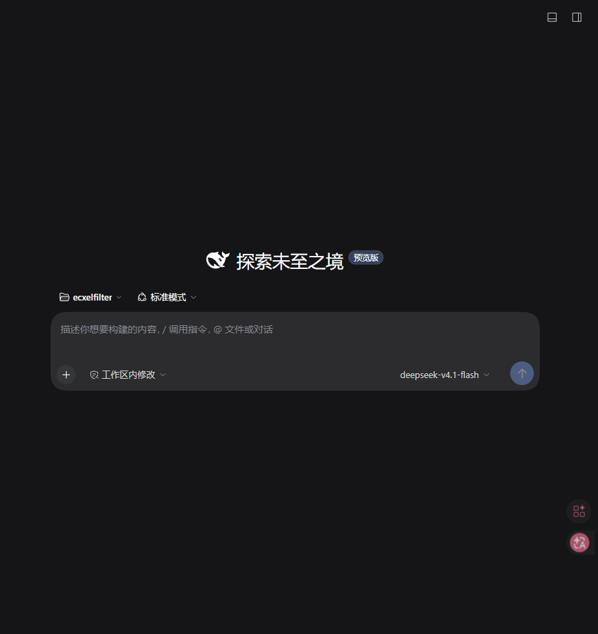
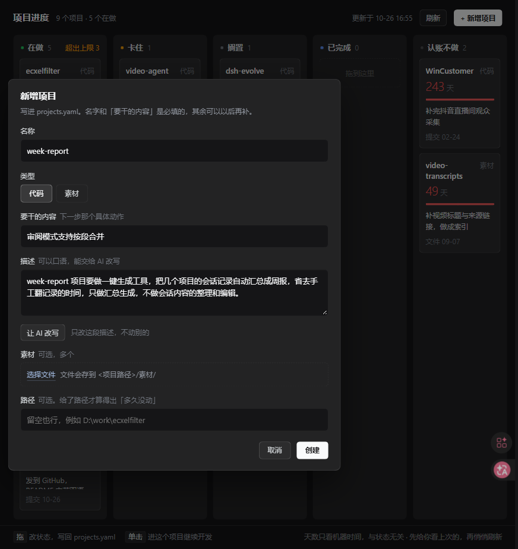

# dsh-project-board

A **native** project board that lives in the DSH Web sidebar. Five columns by status,
**the day count is read from machine evidence only**, drag a card to change its status
(written straight back to `projects.yaml`), click a card to jump back into that project.



English · [中文](README.md)

---

## What it is for

A task board is about *one task*: no card, nothing shows. This is about *one project*:

- **Projects are always there**, even with zero cards.
- **You never maintain the clock.** "Days" is computed from the newest of four signals:
  DSH session records · git commits (plus mtimes of uncommitted files) · newest file change
  in the directory · task-board card activity.
- **The first screen is always the thing you should touch next.** Sorted by "longest untouched",
  not by the order you happened to edit them.

No percentages, no Gantt, and the panel never writes `intent` / `next` — those two sentences
get edited while you talk to the agent.

## Install

Requires a working `dsh web` with the `web` profile.

```powershell
git clone https://github.com/sunzhiyueaa/dsh-project-board.git D:\work\portfolio
cd D:\work\portfolio
copy projects.example.yaml projects.yaml     # then put your own projects in
dsh plugin --profile web add link:D:\work\portfolio
```

**Restart `dsh web` afterwards.** The client plugin manifest is scanned once per process;
without a restart the sidebar row never appears. After that, editing `lib/client.js` only
needs a page refresh — only `package.json`'s `dsh.client` block needs another restart.

## Using it

### Drag → change status

Drop a card on another column and the status is written back to `projects.yaml`
(undo available for 4 seconds).



The column decides the word: `code` dropped on "doing" becomes `building`, `material`
dropped on "doing" becomes `editing`. Nothing is written until you let go.

### Click → continue that project

Opens its most recent session, or creates a workspace + session if there is none.



### New project

"+ 新增项目" in the top right. Name and "what to do" are required; the rest can wait.
The description can be written casually — "让 AI 改写" compresses it into one sentence.



- **Type**: code / material — decides the status vocabulary and where materials go.
- **Materials**: multi-select files, stored under `<project path>/素材/`.
- **Path**: without it the board cannot compute "untouched for N days".

## The data file

One file, `projects.yaml`, next to the plugin.

```yaml
settings:
  staleDays: 5       # untouched longer than this → amber
  zombieDays: 14     # untouched longer than this → red
  wipSoftLimit: 3    # more than this many in "doing" → column header turns amber

projects:
  - id: dsh-project-board
    name: dsh-project-board
    path: D:\work\portfolio
    kind: code            # code | material
    status: building
    intent: one sentence, why this project exists right now
    next: the next concrete action, one sentence
```

Humans write three things: `intent`, `next`, `status` (plus an optional free-text `stage`).
**Never write timestamps** — those are evidence.

Two status vocabularies, on purpose:

| kind | columns | statuses |
|---|---|---|
| `code` | doing / blocked / paused / done / shelved | `building` / `blocked` / `paused` / `shipped` / `shelved` |
| `material` | doing / blocked / paused / done / shelved | `editing` / `blocked` / `paused` / `exported` / `shelved` |

`paused` means "stopped, coming back"; `shelved` means "I am not doing this". Shelved
projects stay on the board — they just stop being your problem.

## How the colours are computed

```
last touched = max(last session, last git commit, newest file mtime, last card activity)
```

- older than `staleDays` (5) → amber
- older than `zombieDays` (14) → red
- a 0–30 day bar with a red tick at 14 days shows how close a project is to being forgotten

This is **completely independent of the `status` you wrote**. Forgetting to update a status
never hides the truth.

## Design choices

- **Colour encodes time, not status.** Status is already the column name; painting it twice
  says nothing new.
- **No percentages.** A project has no denominator; a progress bar is decoration that
  reassures you.
- **Read-only except status.** `intent` / `next` are edited in conversation because they
  need thinking, not typing into a form.
- **Opening never waits.** The host keeps a 15 s cache and revalidates in the background;
  the client paints the previous snapshot from `localStorage` first.
  Measured: 41 ms from click to first card.

## Layout

```
lib/host/index.js     routes, cache, stale-while-revalidate, warm-up
lib/host/evidence.js  evidence folding: sessions / git / file mtimes / board cards
lib/host/edit.js      line-level yaml rewrite (comments preserved), new project, materials
lib/host/ai.js        description rewrite (one llm call, 45 s timeout)
lib/host/page.js      the v1 standalone page (/project-board still works)
lib/client.js         the panel itself — hand-written bundle, no build step
cordis.patch.yml      the one row that mounts it into the profile
docs/                 screenshots
进度交接.md            design + pitfalls log (Chinese, long)
scripts/check.mjs     offline self-check: valid yaml + routes respond
```

## Known limits

- The client plugin manifest is scanned **once per `dsh web` process** — installing it or
  changing `dsh.client` requires a restart.
- Spawning git on Windows is expensive, so git results are cached per path for 20 s and all
  projects are folded in parallel.
- After a write the panel refreshes itself; an external edit takes up to 15 s (or hit 刷新).
- The panel never writes `intent` / `next`. On purpose.

## License

MIT
